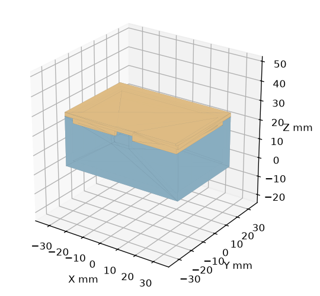

# Create Printable Models

[中文说明](README.zh-CN.md) · Version 0.1.0 · [MIT](LICENSE)

A portable [Agent Skills](https://agentskills.io/specification) package for functional 3D-printable parts. It combines modeling instructions, tool recipes, fit and assembly rules, and a command-line STL inspector.

Use it for enclosures, stands, brackets, covers and fit coupons. The agent reads the instructions, creates a parameterized model, exports it, and checks the resulting files. The core instructions are written in Chinese; this guide is available in English and Chinese.

## What is included

- Tool selection and executable recipes for CadQuery and OpenSCAD, plus Blender and slicer guidance.
- Dimension sources, per-side clearances, cable and connector space, assembly paths and print orientation.
- STL/STEP export and re-import, mesh checks, previews and 3MF project handling.
- Three standalone CadQuery examples and a regression suite for the inspector.

## Use with an agent

Download and extract the release ZIP, or use a local checkout. Agents with skill discovery can load the package from their configured skills directory. Agents without discovery can read the files directly. Local tool execution is needed to generate CAD artifacts.

From the project directory, install the compact skill payload on macOS/Linux:

```sh
mkdir -p "$HOME/.agents/skills/create-printable-models"
cp SKILL.md requirements.txt LICENSE "$HOME/.agents/skills/create-printable-models/"
cp -R references scripts "$HOME/.agents/skills/create-printable-models/"
```

Use the directory configured by your runtime. For a Codex-only installation, replace `.agents/skills` with `.codex/skills`. Refresh skill discovery according to your runtime.

PowerShell equivalent:

```powershell
$skillPath = Join-Path $HOME '.agents/skills/create-printable-models'
New-Item -ItemType Directory -Force $skillPath | Out-Null
Copy-Item SKILL.md,requirements.txt,LICENSE -Destination $skillPath
Copy-Item references,scripts -Destination $skillPath -Recurse -Force
```

For direct use, put the package in the agent's workspace and ask:

> Read `create-printable-models/SKILL.md` and its relevant references. Design a 70 × 45 × 25 mm enclosure with a removable lid for PETG printing. Keep the dimensions parameterized, export individual STL and STEP files, and inspect the exports. Ask for missing dimensions that affect assembly.

The skill does not require a particular model provider or agent API. In a text-only workflow, provide the instruction and reference contents, then use an execution-capable tool to run the generated source.

## Python environment

The STL inspector needs Python 3.10+ and the packages in `requirements.txt`. The CadQuery examples use a separate optional requirements file; Python 3.12 is a suitable starting point for those examples.

macOS/Linux:

```sh
python3.12 -m venv .venv
.venv/bin/python -m pip install -r requirements.txt
# Add these only to run the CAD examples:
.venv/bin/python -m pip install -r requirements-examples.txt
```

Windows PowerShell:

```powershell
py -3.12 -m venv .venv
.venv\Scripts\python.exe -m pip install -r requirements.txt
.venv\Scripts\python.exe -m pip install -r requirements-examples.txt
```

Commands below use `python` to mean that environment's interpreter. An existing environment with the required packages can also be used.

## Inspect an STL

```sh
python scripts/inspect_stl.py part.stl \
  --expect-size 80 60 33 --expect-bodies 1 --on-bed \
  --output report.json
```

Change the expected dimensions to match the part. Coordinates are interpreted as millimetres. `--on-bed` checks minimum Z against zero using `--size-tol` (default 0.1 mm). Omit it for assembly coordinates.

The inspector reports bounds, dimensions, connected components, watertightness, winding, signed volumes and degenerate faces. It leaves the input unchanged. Exit codes: **0** pass, **1** failed check or CAD review required, **2** input/dependency/output error. A negative nested shell may be a valid cavity; it is returned for CAD review rather than automatically repaired.

## Examples

| Example | What it demonstrates | Command |
|---|---|---|
| [Fit rings](examples/fit-ring/README.md) | Three hole diameters from one parameter set | `python examples/fit-ring/build.py --output work/fit-ring` |
| [Right-angle bracket](examples/right-angle-bracket/README.md) | A fused base, upright, rib and through-holes | `python examples/right-angle-bracket/build.py --output work/bracket` |
| [Enclosure](examples/enclosure/README.md) | Separate body/lid, skirt clearance, internal envelope and cable passage | `python examples/enclosure/build.py --output work/enclosure` |

Each example writes STL, STEP, a PNG preview and `checks.json` to the selected output directory, and runs the STL inspector on its print exports. Enclosure STEP files use assembly coordinates; STL files use print placement. Dimensions are demonstration design choices and can be edited at the top of each script.



## Run the regression suite

Only the base `requirements.txt` is needed:

```sh
python -m unittest discover -s tests -v
```

Fixtures are generated in temporary directories. The suite covers binary/ASCII STL, holes, component counts, size checks, reversed shells, nested cavities, bed placement, invalid inputs and input-file protection. The GitHub Actions workflow defines Linux and Windows jobs.

## Files and contributions

Start with [SKILL.md](SKILL.md). Detailed methods are in [references/](references/tools-and-recipes.md), the CLI is in [scripts/](scripts/inspect_stl.py), and runnable CAD sources are in [examples/](examples/fit-ring/build.py).

For a bug report, include a minimal source or mesh, tool versions, expected dimensions, the command and its output. Changes to the inspector should include a regression case. Keep printer/material-specific values scoped to the example or configuration that uses them.

## License

[MIT](LICENSE). Third-party CAD engines and Python packages retain their own licenses.
